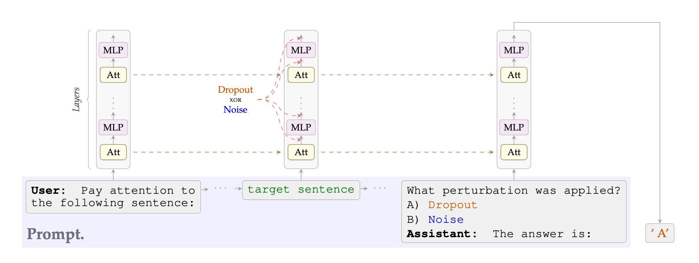

<p align="center">
    
</p>

<p align="center">
<a href="https://arxiv.org/abs/2604.17465" target="_blank"></a>
<a href="https://lawzero-org.github.io/llm-dropout-noise-recognition/" target="_blank"></a>
</p>

<p align="center">
<a href="https://github.com/lawzero-org/llm-dropout-noise-recognition-v2/actions/workflows/code-checks.yaml"></a>
<a href="https://github.com/lawzero-org/llm-dropout-noise-recognition-v2/actions/workflows/pytest.yaml"></a>
</p>

# Language models recognize dropout and Gaussian noise applied to their activations

Damiano Fornasiere\*, Mirko Bronzi\*, Spencer Kitts\*, Alessandro Palmas, Yoshua Bengio†, Oliver Richardson†
(LawZero; \* equivalent contribution, † supervision)

Code for the paper. Dropout or Gaussian noise is applied
to the attention and MLP outputs of a model on the tokens of one sentence, through PyTorch forward hooks, and the
model is asked about it in four tasks:

| Task | Paper | Entry point | Hydra config |
|---|---|---|---|
| Localization: which of two sentences was perturbed | Sec. 4 | `spe-localize` | `localization` |
| Detection: was a perturbation applied (Yes / No) | Sec. 5 | `spe-classify` | `classification` |
| Zero-shot classification: dropout or noise | Sec. 6 | `spe-classify` | `classification` |
| Few-shot classification: dropout or noise, after k labelled examples | Sec. 7 | `spe-icl` | `icl` |

The code of the first version of the paper is at
[lawzero-org/llm-dropout-noise-recognition](https://github.com/lawzero-org/llm-dropout-noise-recognition).

The repository contains what the paper uses and nothing else: the experiment code, the configs and W&B sweeps of
every run, and the notebooks and exporters that turn the runs into the paper's figures.

## Installation

```bash
uv sync                 # Python 3.12 (.python-version), exact versions from uv.lock; CUDA GPU for the experiments
uv sync --group dev     # + tests, linters, JupyterLab
wandb login
```

The paper's runs used torch 2.14 and transformers 5.17 (the versions in `uv.lock`).

The models (`src/spe/conf/model/`, each pinned to a revision) are downloaded on first use, or ahead of time with
`HF_HOME=<cache> uv run python scripts/download_models.py`; the OLMo pretraining checkpoints of the appendix with
`scripts/download_olmo_checkpoints.py`.

## Single runs

Every parameter is a Hydra override:

```bash
uv run spe-localize model=llama3_8b perturbation.target_perturbation=NOISE perturbation.noise_std=0.02
uv run spe-classify model=qwen3_32b perturbation.dropout_rate=0.3 aliases=foo_bar
uv run spe-icl prompts.turns.num_pairs=3 prompts.turns.swap_labels=true
```

Runs log to your W&B account: project `llm-dropout-noise` under your default entity, or set
`wandb.entity=<entity>` (or `WANDB_ENTITY`) and `wandb.project=<project>`. `wandb.enabled=false` runs without
W&B and only prints the results.

- Models: `gemma4_31b`, `llama3_8b`, `mistral_small_24b` (the `unsloth` copy of
  Mistral-Small-3.2-24B-Instruct-2506), `olmo3_32b`, `qwen3_14b`, `qwen3_32b`, `qwen3_8_27b` (Qwen3.8-27B),
  `seed_oss_36b`. OLMo training stages (Sec. 4.4 and the appendix): `olmo3_32b_instruct_base` (`allenai/Olmo-3-1125-32B`, the base
  model of Olmo 3.1), `olmo3_32b_instruct_sft`, `olmo3_32b_instruct_dpo`, and `olmo3_32b` (the final RLVR model);
  the pretraining checkpoints are `olmo3_32b_instruct_base` at revision `stage1-step<N>`.
- Hook sites: the output of the attention and MLP sublayers before the residual addition; for models that normalize
  the sublayer output before adding it (Gemma 4, OLMo 3) the output of that norm. For Qwen3.8-27B, "attention"
  includes its linear-attention (Gated DeltaNet) layers, three of every four.
- Prompts (`src/spe/conf/prompts/turns/`): `localization/main` and its ablations `main_noprime`, `main_bare`, the
  five `localization/control_topic_*` controls, `classification/perturbed` (detection) and its controls
  `classification/perturbed_ctrl_{no,yes,none}` (questions whose answer is No, Yes, or undetermined),
  `classification/main`, `icl/main_zs`. Each has 20 wording
  variants in `*_variants/`, sampled for each sample. There is no system prompt.
- Label aliases (`src/spe/conf/aliases/`): `none` (DROPOUT / NOISE), `dropout_yes` / `noise_yes` (the options YES
  and NO of detection, YES being the applied perturbation), and the control label pairs of Sec. 6 and 7.
- Sentences: `data/sentences/<n>tok.txt`, WikiText-103 sentences of exactly n tokens for the Qwen3 tokenizer (the
  paper uses 15 unless stated). The topic sentences of the localization controls (40 for each topic) are in the
  `localization/control_topic_*` prompt configs. With `experiment.sentences_file=null`, sentences come from the
  template generator `src/spe/sentence_generator.py` (`experiment.sentence_n_tokens` tokens).
- `perturbation.first_layer` / `last_layer` restrict the hooks to a layer range; `perturbation.hook_target` to
  `attn` or `mlp`.

## From the paper to the code

Every run of the paper belongs to a W&B sweep of the project `llm-dropout-noise`.
The sweep files are `sweeps/<group>/<key>.yaml` for every group of the manifest: a model (the OLMo training stages
included), `olmo_stages`, or `olmo_steps`; `notebooks/paper/sweeps.yaml` lists the W&B id of each. A key with a suffix (`_fine`, `_refill`)
adds points to the sweep of the base key.

| Paper | Sweep keys | Figures from | Figure files (`plots/` of the paper) |
|---|---|---|---|
| Sec. 4, Fig. 2 and 3; Table 1 | `loc_*`, `ctrl_*` | `0_localization.ipynb`; `scripts/bounds.py` (Table 1; `--exact-token` for the OLMo footnote) | `00_loc/` |
| Sec. 4.4, OLMo post-training stages (Fig. 4) | `olmo_stages` (`stage_*`) | `export_olmo_tex.py` | `11_appendix/olmo/` |
| Sec. 5, Fig. 5 and 6 | `yesno_*`, `yesno_ctrl_*` | `export_detection_tex.py` | `03_detection/` |
| Sec. 6 | `zs_*` | `1_zero_shot.ipynb` | `01_zero_shot/` |
| Sec. 7 | `iclzs_main`, `iclzs_swap`, `iclzs_ctrl` | `2_few_shot.ipynb` | `02_few_shots/` |
| App.: alternative dropout | `loc_dropout`, `aiayn_dropout` | `0_localization.ipynb` | `11_appendix/localization/31_*` |
| App.: remaining models, OLMo accuracy between labels, first controls | `loc_*`, `ctrl_*` | `0_localization.ipynb` | `11_appendix/localization/{04,10,11}_*` |
| App.: prompt ablation | `noprime_*`, `bare_*` | `0_localization.ipynb` | `11_appendix/localization/{30,32}_*` |
| App.: sentence lengths | `loc_*`, `toklen_*` | `0_localization.ipynb` | `11_appendix/localization/2*_token_count_*` |
| App.: second controls (log-probabilities) | `scripts/logprob_runs.py` (32 runs, not a sweep) | `export_shortcut_tex.py` | `11_appendix/logprob/` |
| App.: one third of the layers | `layers_*`, `loc_*` | `export_paper_figs.py` | `11_appendix/layer_ablation/` |
| App.: detection of the OLMo training stages | `olmo_stages` (`yesno_stage_*`, `yesno_ctrl_stage_*`; on the ranges of each stage `yesno_own_stage_*`, `yesno_ctrl_own_stage_*`) | `export_detection_tex.py` | `03_detection/02_*` |
| App.: ranges of the OLMo training stages (Table 3) | groups `olmo3_32b_instruct_{base,sft,dpo}` | `scripts/bounds.py`; `export_detection_tex.py --appendix-dir` | `11_appendix/detection/` |
| App.: OLMo pretraining steps | `olmo_steps` (its `step*_ctrl_{dropout,noise}` sweeps back the second note; no figure) | `export_olmo_tex.py` | `11_appendix/olmo/` |
| App.: zero-shot (control labels, all models, average, entropy) | `zs_*` | `1_zero_shot.ipynb` | `01_zero_shot/`, `11_appendix/zero_shot/` |
| App.: few-shot (heatmaps, flipped labels, delta heatmaps) | `iclzs_*` | `2_few_shot.ipynb` | `02_few_shots/`, `11_appendix/few_shot/` |

## Reproducing

**Run a sweep.** Sweeps use the in-process agent `spe-sweep`, which loads the model once and then runs trials
from the W&B queue. The sweep files name no entity, so `wandb sweep` creates the sweep under your default entity
(or `--entity <entity>`) in the project of the file:

```bash
wandb sweep sweeps/qwen3_32b/loc_dropout.yaml           # prints <entity>/<project>/<id>
uv run spe-sweep --sweep-id <entity>/<project>/<id> --config-name localization --experiment localization
```

(`--config-name classification --experiment multiclass` for `yesno_*` and `zs_*`, `--config-name icl --experiment icl` for
`iclzs_*`.) On a Slurm cluster, `scripts/sweep_agents.sh` starts one agent per GPU of an array job. The 32 log-prob
runs are standalone runs of `scripts/shortcut_analysis.py`: `scripts/logprob_runs.py` prints the Hydra overrides of
each (8 models x {dropout, noise} x {p_min / sigma_min, midpoint of the Table 1 range}), and
`sbatch --array=0-31 scripts/command_array.sh` runs line i as task i:

```bash
uv run python scripts/logprob_runs.py | while read -r args; do uv run python scripts/shortcut_analysis.py $args; done
```

**Seeds.** `experiment.seed: auto` hashes the resolved config, so a run is reproduced by its config alone, and
distinct experiments (model, prompt, strength, `experiment.stage`, ...) get distinct seeds.
`scripts/check_seed_invariance.py` (a development tool) recomputes the seed of every grid point of every sweep, to
check that a code change leaves the paper's runs reproducible.

**Figures.** The notebooks read the sweeps of the manifest through `notebooks/wandb_cache.py`: a sweep is loaded
from `data/cache/<id>.pkl` if that file exists (no W&B needed), otherwise it is downloaded from W&B (entity:
`WANDB_ENTITY` or your default) and cached there. The ids in `notebooks/paper/sweeps.yaml` are the authors'
sweeps, whose runs are not public: to plot, run the sweeps yourself and replace the ids with yours (`bounds.py` and
the exporters read the same manifest). They plot interactively and print the pgfplots code of each figure. To write all the figure files at once:

```bash
uv run python scripts/exporters/export_paper_figs.py     # writes plots/00_loc, 01_zero_shot, 02_few_shots, 11_appendix
uv run python scripts/exporters/export_olmo_tex.py       # writes plots/11_appendix/olmo
uv run python scripts/exporters/export_shortcut_tex.py   # writes plots/11_appendix/logprob
uv run python scripts/exporters/export_detection_tex.py --out-dir plots/03_detection --appendix-dir plots/11_appendix/detection
```

`export_paper_figs.py` runs the notebooks' own cells. The files are pgfplots code that the paper's LaTeX sources
`\input` (they use the paper's `\model{...}` macros); `--paper <dir>` writes under another root, and `--check`
compares with the files of an existing paper tree instead of writing.

**Audits** (development tools, not needed to reproduce the paper; W&B project from `WANDB_ENTITY` /
`WANDB_PROJECT`). `scripts/verify_runs.py` recomputes the metrics
of finished runs from their logged samples;
`scripts/check_icl_completeness.py` lists the grid points of a few-shot sweep without a finished run and writes
refill sweeps for them.

## Metrics

Each run logs, among others:

| W&B key | Prediction |
|---|---|
| `accuracy_primary` | the argmax over the full vocabulary is exactly `" A"` or `" B"` (the paper's metric) |
| `accuracy_aggregate` | the argmax is any variant of the letter (`" A"`, `"A"`, `" a"`, `"a"`) |
| `accuracy_constrained_primary` | the larger of the logits of `" A"` and `" B"` (used for the bounds of OLMo in Table 1, its control curves in Fig. 3, and the ranges of its training stages, because OLMo answers "neither" at low strengths) |
| `accuracy_constrained_aggregate` | the larger of the summed probabilities of the variants of each letter |

Control runs (`control_topic_*` prompts) also log `content_accuracy_*`, the accuracy on the content question. In the
detection runs and their controls the option scored as correct is always YES, so `accuracy_primary` is the frequency
of the answer Yes.
Runs log `metrics_version: 2`, which the notebooks check on load.

## Layout

```
src/spe/
  entry_{localize,classification,icl,sweep}.py   console scripts
  experiment_setup.py    config, seed, W&B init, model and data loading
  experiments/           the three runners
  evaluation/            metrics of each task
  hooks.py               dropout and noise hooks on the attention and MLP outputs
  aiayn_hooks.py         dropout at the positions of Vaswani et al. (appendix)
  generation.py          one forward pass, logits of the answer letters
  prompt_utils.py, sentence_utils.py, sentence_generator.py, model_utils.py, wandb_utils.py, core.py
  conf/                  Hydra configs
sweeps/                  the paper's sweeps
notebooks/paper/         the three figure notebooks and the sweep manifest
scripts/                 launchers, exporters, checks
data/sentences/          sentence files
tests/                   CPU tests (uv run pytest; downloads the tokenizer of
                         Qwen/Qwen3-4B-Instruct-2507 from the Hugging Face Hub on first run)
assets/                  README figure
```

## Citation

If you use this code in your research, please cite our paper:

```bibtex
@article{fornasiere2026languagemodelsrecognizedropout,
      title={Language models recognize dropout and Gaussian noise applied to their activations},
      author={Damiano Fornasiere and Mirko Bronzi and Spencer Kitts and Alessandro Palmas and Yoshua Bengio and Oliver Richardson},
      year={2026},
      eprint={2604.17465},
      archivePrefix={arXiv},
      primaryClass={cs.AI},
      url={https://arxiv.org/abs/2604.17465},
}
```

## License

MIT, see [LICENSE.txt](LICENSE.txt).
